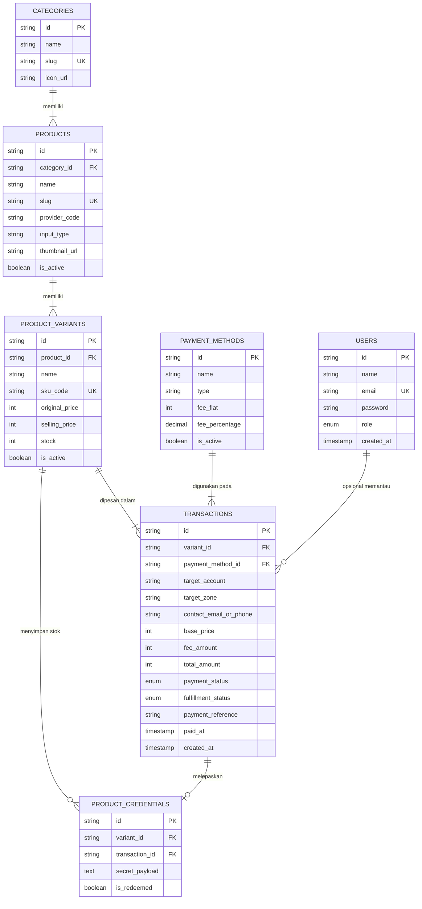

# Panduan Lengkap Backend & Basis Data (Tugas Mario)
**Mari Shop - E-Commerce Top-Up Game & Digital Goods**  
*Mata Kuliah: Pengantar Basis Data (Kelas A1)*

---

## 1. Ringkasan Peran & Tanggung Jawab Mario

Sebagai pengembang **Backend & Basis Data**, peran Mario adalah jantung dari sistem Mari Shop. Frontend (tampilan toko yang dibuat oleh Haqqi dan Rifqi) membutuhkan backend yang kokoh untuk memproses transaksi, menyimpan riwayat pesanan, mengelola stok varian produk, dan menyerahkan kode voucher/akun digital secara otomatis.

### Tugas Utama Mario:
1. **Mengelola Basis Data Relasional MySQL**:
   - Memastikan skema tabel di `database/schema.sql` terpasang dengan baik di MySQL lokal (XAMPP / Laragon) maupun MySQL Cloud (Aiven / TiDB / Clever Cloud).
   - Menjaga relasi antar tabel (Foreign Keys, Primary Keys, Constraints).
2. **Menyediakan & Menyempurnakan REST API**:
   - Menghubungkan route di `src/routes/api.js` ke MySQL sungguhan menggunakan *prepared statements* (mencegah SQL Injection).
   - Memastikan logika bisnis berjalan rapi: cek ketersediaan stok, kalkulasi biaya admin pembayaran, pembaruan status transaksi saat dibayar, dan pengiriman kredensial akun/voucher.
3. **Membantu Tim ERD**:
   - Menyediakan referensi struktur tabel yang jelas agar anggota tim yang bertugas menggambar ERD (Entity Relationship Diagram) dapat menyusun laporan dengan tepat dan mendapat nilai maksimal dari dosen/asisten laboratorium.

---

## 2. Apa Saja yang Harus Dibuat (Checklist Deliverables)

Berikut adalah daftar pekerjaan konkrit yang perlu dipastikan oleh Mario:

- [x] **Skema Basis Data DDL & Seeder** (`database/schema.sql`):
  - 7 tabel relasional (`users`, `categories`, `products`, `product_variants`, `payment_methods`, `transactions`, `product_credentials`).
  - Data awal lengkap (5 kategori, 29 produk, varian harga, metode pembayaran QRIS/VA/E-Wallet).
- [x] **Koneksi Database Pool** (`src/config/db.js`):
  - Menggunakan library `mysql2/promise` dengan konfigurasi pool koneksi.
  - Dukungan otomatis koneksi lokal maupun cloud dengan SSL.
- [ ] **Verifikasi Koneksi MySQL Lokal**:
  - Menjalankan MySQL lokal dan membuat database `db_ecommerce_topup`.
  - Mengisi kredensial di file `.env` agar server menampilkan pesan hijau: `✅ [Database] Berhasil terhubung ke MySQL`.
- [ ] **Pengujian Logika Transaksi & Inventori**:
  - Logika transaksi saat pelanggan checkout (`POST /api/orders`).
  - Logika pemotongan stok otomatis dan pelepasan akun rahasia (`POST /api/orders/:id/pay`).
  - Pencarian riwayat order via WhatsApp/Email (`GET /api/orders?contact=...`).
- [ ] **Kolaborasi Penyusunan ERD**:
  - Memberikan dokumentasi relasi dan kardinalitas tabel kepada anggota tim yang bertugas membuat ERD dan laporan Tugas Besar.

---

## 3. Cara Menjalankan & Mengembangkan Backend (Langkah demi Langkah)

### Langkah 1: Menyalakan Layanan MySQL
Mario dapat menggunakan salah satu dari opsi berikut:
- **XAMPP / Laragon**: Nyalakan modul MySQL dari Control Panel (biasanya berjalan di port `3306`).
- **MySQL Command Line / Docker**: Pastikan service `mysqld` aktif.

### Langkah 2: Import Skema Basis Data
1. Buka antarmuka manajemen database seperti **phpMyAdmin** (`http://localhost/phpmyadmin`) atau aplikasi **DBeaver** / **Navicat**.
2. Buat database baru bernama `db_ecommerce_topup` (atau biarkan script membuatnya otomatis).
3. Buka tab **Import** dan pilih file `database/schema.sql`, lalu klik **Go / Kirim**.
4. Alternatif lewat terminal:
   ```bash
   mysql -u root -p < database/schema.sql
   ```

### Langkah 3: Konfigurasi File Environment (.env)
Buat atau edit file `.env` di direktori utama proyek:
```env
PORT=3000
DB_HOST=localhost
DB_USER=root
DB_PASSWORD=
DB_NAME=db_ecommerce_topup
DB_PORT=3306
DB_SSL=false
```
*(Catatan: Jika memakai XAMPP di Windows, password default `root` biasanya dikosongkan).*

### Langkah 4: Menjalankan Server Node.js
Jalankan perintah berikut di terminal proyek:
```bash
npm install
npm run dev
```
Jika konfigurasi berhasil, terminal akan memunculkan output:
```text
====================================================
🚀 [Server] Web E-Commerce berjalan di: http://localhost:3000
🎨 [Frontend] Frontend files di: /public (Rifqi & Haqqi)
🔌 [API] REST API endpoint aktif di: http://localhost:3000/api
====================================================
✅ [Database] Berhasil terhubung ke MySQL database: db_ecommerce_topup
```

---

## 4. Cara Menulis Kueri SQL di Kode Backend

Semua operasi query ke MySQL di proyek ini menggunakan `pool.query()` dari `mysql2/promise`. Selalu gunakan parameter placeholder tanda tanya (`?`) untuk keamanan data dan mencegah serangan SQL Injection.

### Contoh 1: Mengambil Data (SELECT)
```javascript
const { pool } = require("../config/db");

// Mengambil semua produk aktif berdasarkan kategori
async function getProductsByCategory(categorySlug) {
  const query = `
    SELECT p.*, c.name AS category_name, c.slug AS category_slug
    FROM products p
    JOIN categories c ON p.category_id = c.id
    WHERE c.slug = ? AND p.is_active = TRUE
    ORDER BY p.name ASC
  `;
  const [rows] = await pool.query(query, [categorySlug]);
  return rows;
}
```

### Contoh 2: Menambah Data Transaksi Baru (INSERT)
```javascript
// Membuat pesanan baru
async function createOrder(orderData) {
  const query = `
    INSERT INTO transactions (
      id, variant_id, payment_method_id, target_account, 
      target_zone, contact_email_or_phone, base_price, 
      fee_amount, total_amount, payment_status, fulfillment_status, 
      payment_reference, created_at
    ) VALUES (?, ?, ?, ?, ?, ?, ?, ?, ?, "unpaid", "pending", ?, NOW())
  `;
  
  await pool.query(query, [
    orderData.id,
    orderData.variant_id,
    orderData.payment_method_id,
    orderData.target_account,
    orderData.target_zone || null,
    orderData.contact_email_or_phone,
    orderData.base_price,
    orderData.fee_amount,
    orderData.total_amount,
    orderData.payment_reference
  ]);
}
```

### Contoh 3: Pembaruan Status & Pelepasan Akun (UPDATE & TRANSAKSI)
Saat pelanggan membayar pesanan aplikasi premium (misalnya Netflix / Spotify):
1. Ubah status transaksi menjadi `paid` dan `success`.
2. Ambil 1 akun dari tabel `product_credentials` yang belum terpakai (`is_redeemed = FALSE`).
3. Tandai akun tersebut sebagai `is_redeemed = TRUE` dan kaitkan dengan `transaction_id`.
```javascript
// Simulasi pembayaran dan pelepasan akun/voucher
async function processPayment(transactionId) {
  const connection = await pool.getConnection();
  try {
    await connection.beginTransaction();

    // 1. Ambil data pesanan
    const [txRows] = await connection.query(
      "SELECT * FROM transactions WHERE id = ? FOR UPDATE", 
      [transactionId]
    );
    if (!txRows.length) throw new Error("Pesanan tidak ditemukan");
    const tx = txRows[0];

    // 2. Update status pesanan jadi paid
    await connection.query(
      "UPDATE transactions SET payment_status = "paid", fulfillment_status = "success", paid_at = NOW() WHERE id = ?",
      [transactionId]
    );

    // 3. Jika ada varian yang membutuhkan akun rahasia/voucher, pasangkan kredensial
    const [credRows] = await connection.query(
      "SELECT id, secret_payload FROM product_credentials WHERE variant_id = ? AND is_redeemed = FALSE LIMIT 1 FOR UPDATE",
      [tx.variant_id]
    );

    if (credRows.length > 0) {
      const cred = credRows[0];
      await connection.query(
        "UPDATE product_credentials SET is_redeemed = TRUE, transaction_id = ? WHERE id = ?",
        [transactionId, cred.id]
      );
    }

    await connection.commit();
    return { success: true };
  } catch (err) {
    await connection.rollback();
    throw err;
  } finally {
    connection.release();
  }
}
```

---

## 5. Contoh Struktur Data (JSON API Contract)

Frontend dan Backend berkomunikasi melalui format JSON. Berikut adalah struktur data yang wajib dijaga konsistensinya:

### A. Endpoint Pembuatan Pesanan: `POST /api/orders`
**Request Body (Dikirim dari Frontend):**
```json
{
  "variant_id": "var-mlbb-86",
  "payment_method_id": "qris",
  "target_account": "12345678",
  "target_zone": "2024",
  "contact": "081234567890"
}
```

**Response Body (201 Created):**
```json
{
  "success": true,
  "message": "Pesanan berhasil dibuat",
  "data": {
    "id": "TRX-20261103-A8F1",
    "product_name": "Mobile Legends: Bang Bang",
    "variant_name": "86 Diamonds",
    "target_account": "12345678",
    "target_zone": "2024",
    "contact": "081234567890",
    "payment_method": {
      "id": "qris",
      "name": "QRIS Instan",
      "type": "qris"
    },
    "base_price": 19500,
    "fee_amount": 500,
    "total_amount": 20000,
    "payment_status": "unpaid",
    "fulfillment_status": "pending",
    "payment_reference": "00020101021226670016ID.CO.MARISHOP.WWW...",
    "created_at": "2026-11-03T12:00:00Z"
  }
}
```

### B. Endpoint Cek Status Pesanan / Invoice: `GET /api/orders/:id`
**Response Body (200 OK):**
```json
{
  "success": true,
  "data": {
    "id": "TRX-20261103-A8F1",
    "payment_status": "paid",
    "fulfillment_status": "success",
    "secret_payload": "user: premium_member@gmail.com | pass: rahasia2026",
    "paid_at": "2026-11-03T12:05:00Z"
  }
}
```

---

## 6. Panduan Khusus Pembuatan ERD (Entity Relationship Diagram)

Bagian ini ditujukan untuk anggota tim yang memiliki jobdesk menggambar **ERD (Entity Relationship Diagram)** untuk laporan Tugas Besar Basis Data.

### Mengapa ERD Sangat Penting di Tubes Ini?
Dosen dan asisten laboratorium Basis Data akan menilai:
1. **Derajat Relasi**: Apakah relasi antar entitas sudah benar (1-to-1, 1-to-Many, Many-to-Many).
2. **Kunci Primer (PK) & Kunci Asing (FK)**: Setiap tabel memiliki penanda unik dan referensi keterhubungan yang tepat.
3. **Normalisasi**: Skema Mari Shop sudah berada dalam bentuk normal ketiga (3NF) karena tidak ada redundansi data transaksi dan atribut turunan disimpan secara teratur.

### Daftar 7 Entitas Mari Shop Beserta Atributnya:

1. **`users` (Pengguna & Administrator)**
   - `id` (VARCHAR 36, PK)
   - `name` (VARCHAR 100)
   - `email` (VARCHAR 150, UNIQUE)
   - `password` (VARCHAR 255)
   - `role` (ENUM: "customer", "admin")
   - `created_at` (TIMESTAMP)

2. **`categories` (Kategori Produk)**
   - `id` (VARCHAR 36, PK)
   - `name` (VARCHAR 100) - contoh: Game Populer, Pulsa & Kuota
   - `slug` (VARCHAR 100, UNIQUE)
   - `icon_url` (VARCHAR 255)

3. **`products` (Katalog Item)**
   - `id` (VARCHAR 36, PK)
   - `category_id` (VARCHAR 36, FK merujuk ke `categories.id`)
   - `name` (VARCHAR 150)
   - `slug` (VARCHAR 150, UNIQUE)
   - `provider_code` (VARCHAR 50)
   - `input_type` (VARCHAR 50) - contoh: user_id_zone, phone_number
   - `thumbnail_url` (VARCHAR 255)
   - `is_active` (BOOLEAN)

4. **`product_variants` (Pilihan Nominal & Harga)**
   - `id` (VARCHAR 36, PK)
   - `product_id` (VARCHAR 36, FK merujuk ke `products.id`)
   - `name` (VARCHAR 150) - contoh: 86 Diamonds, Pulsa 50.000
   - `sku_code` (VARCHAR 100, UNIQUE)
   - `original_price` (INT)
   - `selling_price` (INT)
   - `stock` (INT)
   - `is_active` (BOOLEAN)

5. **`payment_methods` (Kanal Pembayaran)**
   - `id` (VARCHAR 50, PK) - contoh: qris, bca_va, dana
   - `name` (VARCHAR 100)
   - `type` (VARCHAR 50)
   - `fee_flat` (INT)
   - `fee_percentage` (DECIMAL 5,2)
   - `is_active` (BOOLEAN)

6. **`transactions` (Pesanan / Invoice)**
   - `id` (VARCHAR 50, PK) - contoh: TRX-20261103-XXXX
   - `variant_id` (VARCHAR 36, FK merujuk ke `product_variants.id`)
   - `payment_method_id` (VARCHAR 50, FK merujuk ke `payment_methods.id`)
   - `target_account` (VARCHAR 100)
   - `target_zone` (VARCHAR 50, NULL)
   - `contact_email_or_phone` (VARCHAR 100)
   - `base_price` (INT)
   - `fee_amount` (INT)
   - `total_amount` (INT)
   - `payment_status` (ENUM: "unpaid", "paid", "expired", "failed")
   - `fulfillment_status` (ENUM: "pending", "processing", "success", "failed")
   - `payment_reference` (VARCHAR 255, NULL)
   - `paid_at` (TIMESTAMP, NULL)
   - `created_at` (TIMESTAMP)

7. **`product_credentials` (Stok Akun / Voucher Digital)**
   - `id` (VARCHAR 36, PK)
   - `variant_id` (VARCHAR 36, FK merujuk ke `product_variants.id`)
   - `transaction_id` (VARCHAR 50, FK merujuk ke `transactions.id`, NULL jika belum terjual)
   - `secret_payload` (TEXT)
   - `is_redeemed` (BOOLEAN)

---

### Diagram Relasi ERD (Visualisasi Tabel)

Berikut diagram relasi tabel yang dapat divisualisasikan langsung:



### Penjelasan Kardinalitas Relasi untuk Laporan:
1. **`categories` ke `products` (One-to-Many / 1 : N)**:
   - Satu kategori (misalnya *Game Populer*) dapat menaungi banyak produk (*Mobile Legends, Free Fire, Genshin Impact*).
   - Setiap produk hanya dimiliki oleh satu kategori induk.
2. **`products` ke `product_variants` (One-to-Many / 1 : N)**:
   - Satu produk game/layanan dapat memiliki banyak varian paket nominal (misal *86 Diamonds, 172 Diamonds, Twilight Pass*).
3. **`product_variants` ke `transactions` (One-to-Many / 1 : N)**:
   - Satu varian paket dapat dibeli dalam banyak transaksi yang berbeda.
4. **`payment_methods` ke `transactions` (One-to-Many / 1 : N)**:
   - Satu metode pembayaran (misal *QRIS*) dapat digunakan untuk memproses banyak transaksi.
5. **`product_variants` ke `product_credentials` (One-to-Many / 1 : N)**:
   - Varian akun/voucher (misal *Netflix 1 Bulan*) memiliki sekumpulan stok akun unik di tabel kredensial.
6. **`transactions` ke `product_credentials` (One-to-One Opsional / 1 : 0..1)**:
   - Sebuah transaksi yang sukses hanya mendapatkan 1 kredensial akun digital atau kode voucher. Kredensial yang belum terjual memiliki nilai `transaction_id = NULL`.

### Alat Rekomendasi untuk Menggambar ERD:
1. **dbdiagram.io** (Sangat direkomendasikan): Cukup ketik sintaks database atau import langsung file `database/schema.sql`, gambar ERD akan terbuat otomatis dalam resolusi tinggi dan format modern.
2. **draw.io** / **app.diagrams.net**: Cocok jika asisten laboratorium meminta format notasi Chen atau Crows Foot klasik.
3. **MySQL Workbench (Reverse Engineer)**: Menu *Database -> Reverse Engineer*, pilih file skema, maka Workbench akan menggambar skema relasi secara instan.

---

## 7. Tips Menghadapi Pengujian & Presentasi Tugas Besar

1. **Jaga Mock Data Fallback Tetap Aman**:
   - Jika saat presentasi laptop Mario terkendala koneksi MySQL, server Mari Shop memiliki mekanisme otomatis: server tetap berjalan lancar menggunakan data memori (*graceful fallback*) tanpa menampilkan error putih di hadapan dosen.
2. **Perlihatkan Query Log atau phpMyAdmin Saat Demo**:
   - Tunjukkan perubahan data nyata di MySQL:
     - Sebelum checkout: periksa stok awal varian.
     - Lakukan checkout di web frontend: tunjukkan baris baru muncul di tabel `transactions`.
     - Klik bayar: tunjukkan kolom `payment_status` berubah dari `unpaid` menjadi `paid`, dan kredensial terikat ke transaksi.
3. **Jelaskan Keunggulan Prepared Statement**:
   - Dosen sering menanyakan keamanan aplikasi terhadap serangan SQL Injection. Mario dapat menunjukkan bahwa seluruh query menggunakan parameter binding (`?`) pada `pool.query()`.
