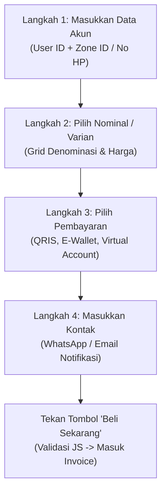

# 🎨 STANDAR DESAIN ANTARMUKA & SISTEM TAMPILAN (DESIGN SYSTEM)
**Platform**: E-Commerce Top-Up Game, Pulsa/Data, Voucher & Akun Premium  
**Gaya Desain**: **Neo-Brutalism** (Referensi: *Gumroad, YouTube Studio Neo-Brutalist, Oatside*)  
**Target Pengembang**: Tim Frontend (Haqqi & Rifqi)  
**Versi**: 1.0.0 — November 2026

---

## 📌 DAFTAR ISI
1. [Filosofi & Prinsip Desain](#1-filosofi--prinsip-desain)
2. [Design Tokens & Variabel CSS](#2-design-tokens--variabel-css)
3. [Tipografi & Hierarki Teks](#3-tipografi--hierarki-teks)
4. [Sistem Grid, Layout & Blueprint Canvas](#4-sistem-grid-layout--blueprint-canvas)
5. [Komponen Standar UI (Atomic & Components)](#5-komponen-standar-ui)
6. [Alur & Blueprint Halaman Utama](#6-alur--blueprint-halaman-utama)
7. [Iconography, Stiker & Penanganan Aset](#7-iconography-stiker--penanganan-aset)
8. [Perilaku Interaksi, State & Mikro-Animasi](#8-perilaku-interaksi-state--mikro-animasi)
9. [Tata Kelola File & Kolaborasi Frontend (Haqqi & Rifqi)](#9-tata-kelola-file--kolaborasi-frontend)
10. [Checklist Kesiapan Review](#10-checklist-kesiapan-review)

---

## 1. Filosofi & Prinsip Desain

Desain antarmuka memadukan kecepatan transaksi ala marketplace digital (*Itemku, Codashop*) dengan estetika visual **Neo-Brutalism**:

* **Bold & High Contrast**: Garis tepi tegas (`border: 3px solid #121212`), bayangan keras tanpa blur (`box-shadow: 4px 4px 0px #121212`), kontras warna tinggi untuk keterbacaan instan.
* **Tactile & Responsive (Fisik)**: Tombol dan kartu dirancang menyerupai tombol fisik. Saat diklik/ditekan (*active*), elemen menekan ke bawah (`transform: translate(2px, 2px)`) dan bayangan menyusut.
* **Organized Bento Grid**: Informasi dikelompokkan dalam kotak-kotak partisi modular teratur (terinspirasi dari *YouTube Studio Dashboard* & *Gumroad*).
* **Playful yet Trustworthy**: Aksen warna pop cerah (kuning lemon, neon green, coral red, elektrik blue) dipadukan dengan latar belakang krem hangat (*off-white warm canvas*) dan pola kertas milimeter / grid halus (*subtle graph grid* ala *Oatside*).
* **Speed-First UX (Fast Checkout)**: Pengunjung harus bisa melakukan top-up dalam **3-4 langkah instan di satu layar** tanpa navigasi berbelit.

---

## 2. Design Tokens & Variabel CSS

Gunakan variabel CSS global ini di berkas utama `style.css` agar konsistensi warna, border, dan bayangan terjaga di seluruh halaman:

```css
:root {
  /* --- PALET WARNA DASAR (CANVAS & BASE) --- */
  --bg-canvas: #FBF8F1;          /* Krem hangat / Warm off-white khas Neo-Brutalism */
  --bg-card: #FFFFFF;            /* Putih murni untuk kartu & kontainer */
  --bg-muted: #F2EDE2;           /* Krem abu untuk field input disabled / subtle container */
  --border-color: #121212;       /* Hitam pekat solid untuk semua border */
  --text-main: #121212;          /* Teks utama (high contrast) */
  --text-muted: #666666;         /* Teks sekunder / caption */

  /* --- BRAND & ACCENT COLORS (POP VIBRANT) --- */
  --accent-yellow: #FFE600;      /* Primary CTA / Highlight / Badge Promo */
  --accent-blue: #3B82F6;        /* Akun Premium / Info / Link */
  --accent-green: #00E599;       /* Pulsa & Kuota / Status Sukses / Instant Buy */
  --accent-coral: #FF5353;       /* Top-Up Game / Diskon / Hot Deals */
  --accent-purple: #A78BFA;      /* Voucher & Gift Card */
  --accent-pink: #FF70A6;        /* Flash Sale / Stiker Promo */
  --accent-orange: #FF9F1C;      /* Tagihan & Pajak PPOB */

  /* --- SEMANTIC COLORS --- */
  --state-success: #10B981;      /* Status Transaksi: Berhasil */
  --state-warning: #F59E0B;      /* Status Transaksi: Menunggu Pembayaran */
  --state-danger: #EF4444;       /* Status Transaksi: Gagal / Expired */
  --state-info: #0284C7;         /* Status Transaksi: Sedang Diproses */

  /* --- BORDERS & SHADOWS (NEO-BRUTALISM CORE) --- */
  --border-width: 3px;
  --border-style: solid var(--border-color);
  --border-radius-sm: 6px;
  --border-radius-md: 10px;
  --border-radius-lg: 16px;
  --border-radius-pill: 9999px;

  /* Hard Shadows (Tanpa Blur) */
  --shadow-sm: 2px 2px 0px var(--border-color);
  --shadow-md: 4px 4px 0px var(--border-color);
  --shadow-lg: 6px 6px 0px var(--border-color);
  --shadow-hover: 6px 6px 0px var(--border-color);
  --shadow-active: 0px 0px 0px var(--border-color);

  /* --- TYPOGRAPHY SCALE --- */
  --font-family-heading: 'Space Grotesk', 'Plus Jakarta Sans', system-ui, sans-serif;
  --font-family-body: 'Plus Jakarta Sans', -apple-system, BlinkMacSystemFont, sans-serif;
  --font-family-mono: 'JetBrains Mono', 'Courier New', monospace;

  /* --- TRANSITIONS --- */
  --transition-fast: 0.12s cubic-bezier(0.4, 0, 0.2, 1);
}
```

---

## 3. Tipografi & Hierarki Teks

### Font Stack yang Disarankan
* **Heading / Display**: `Space Grotesk` (Weight: 700 / 800) atau `Plus Jakarta Sans` (Weight: 800). Karakter huruf tegas, berbobot, dan geometris.
* **Body / Antarmuka**: `Plus Jakarta Sans` (Weight: 500 regular, 600 semi-bold, 700 bold).
* **Data Monospace / Kode / Harga**: `JetBrains Mono` atau font monospace bawaan untuk Order ID, Kode Voucher, Nomor Tagihan, dan Saldo/Nominal.

### Aturan Skala Tipografi
| Level | Ukuran (px / rem) | Weight | Line Height | Contoh Pemakaian |
| :--- | :--- | :--- | :--- | :--- |
| **Hero Display** | 44px – 56px (3.5rem) | 800 (Extrabold) | 1.1 | Headline Banner Utama, Promo Besar |
| **H1** | 32px – 36px (2.25rem) | 800 (Extrabold) | 1.2 | Nama Produk ("Mobile Legends", "Spotify Premium") |
| **H2 / Section** | 24px – 28px (1.6rem) | 700 (Bold) | 1.3 | Judul Step ("1. Masukkan User ID", "2. Pilih Nominal") |
| **H3 / Card Title** | 18px – 20px (1.25rem)| 700 (Bold) | 1.4 | Judul Paket / Varian ("86 Diamonds", "1 Bulan Sharing") |
| **Body Large** | 16px (1.0rem) | 600 (Semibold) | 1.5 | Deskripsi pendek, label harga |
| **Body Regular** | 14px (0.875rem) | 500 (Medium) | 1.5 | Teks form, penjelasan instruksi, opsi pembayaran |
| **Caption / Tiny**| 12px (0.75rem) | 600 (Semibold) | 1.4 | Tag koin, status fee, catatan kecil |
| **Monospace Tag** | 13px (0.8125rem) | 700 (Bold) | 1.2 | Invoice ID `#TRX-982138`, SKU `ML-86DM` |

---

## 4. Sistem Grid, Layout & Blueprint Canvas

### 1. Blueprint Grid Background (Oatside & Gumroad Style)
Untuk memperkuat aksen arsitektural neo-brutalis, latar belakang halaman dapat menggunakan pola grid kotak-kotak tipis:
```css
body {
  background-color: var(--bg-canvas);
  background-image: 
    linear-gradient(to right, rgba(18, 18, 18, 0.05) 1px, transparent 1px),
    linear-gradient(to bottom, rgba(18, 18, 18, 0.05) 1px, transparent 1px);
  background-size: 28px 28px;
  color: var(--text-main);
  font-family: var(--font-family-body);
  margin: 0;
  padding: 0;
}
```

### 2. Container & Breakpoints
* **Max Width Container**: `1200px` (terpusat: `margin: 0 auto; padding: 0 16px;`)
* **Breakpoints**:
  * **Desktop**: `> 1024px` (Layout multi-kolom bento grid, sidebar checkout tetap terlihat)
  * **Tablet**: `768px – 1023px` (Grid 2 atau 3 kolom)
  * **Mobile**: `< 768px` (Single column flow, bottom checkout bar mengambang / sticky)

### 3. Bento Grid Partitions
Gunakan sistem grid rapi dengan celah tegas:
```css
.bento-grid {
  display: grid;
  grid-template-columns: repeat(12, 1fr);
  gap: 20px;
}
```

---

## 5. Komponen Standar UI

Setiap komponen wajib mematuhi aturan dasar: **Border Hitam 3px**, **Sudut membulat 8-12px**, dan **Bayangan Datar Solid**.

### A. Tombol (Buttons)
```css
/* Base Button */
.btn {
  display: inline-flex;
  align-items: center;
  justify-content: center;
  gap: 8px;
  font-family: var(--font-family-heading);
  font-weight: 700;
  font-size: 14px;
  padding: 12px 20px;
  border-radius: var(--border-radius-md);
  border: var(--border-width) solid var(--border-color);
  box-shadow: var(--shadow-md);
  cursor: pointer;
  text-decoration: none;
  transition: all var(--transition-fast);
  user-select: none;
}

/* Hover State */
.btn:hover {
  transform: translate(-2px, -2px);
  box-shadow: var(--shadow-hover);
}

/* Active / Pressed State (Tactile feedback) */
.btn:active {
  transform: translate(2px, 2px);
  box-shadow: var(--shadow-active);
}

/* Tombol Primary (Kuning Neon) */
.btn-primary {
  background-color: var(--accent-yellow);
  color: var(--text-main);
}

/* Tombol Sukses / Beli Langsung (Hijau Neon) */
.btn-success {
  background-color: var(--accent-green);
  color: var(--text-main);
}

/* Tombol Sekunder (Putih Bersih) */
.btn-secondary {
  background-color: var(--bg-card);
  color: var(--text-main);
}

/* Tombol Bahaya / Batal (Coral Red) */
.btn-danger {
  background-color: var(--accent-coral);
  color: #FFFFFF;
}
```

---

### B. Kartu Kontainer (Cards & Bento Blocks)
Semua blok konten (kategori, daftar produk, form input) dibungkus oleh `.brutal-card`:
```css
.brutal-card {
  background: var(--bg-card);
  border: var(--border-width) solid var(--border-color);
  border-radius: var(--border-radius-lg);
  box-shadow: var(--shadow-md);
  padding: 24px;
  position: relative;
}

/* Variasi Header Kartu Berwarna */
.brutal-card-header {
  border-bottom: var(--border-width) solid var(--border-color);
  padding: 12px 20px;
  margin: -24px -24px 20px -24px;
  background-color: var(--accent-yellow);
  border-top-left-radius: calc(var(--border-radius-lg) - 3px);
  border-top-right-radius: calc(var(--border-radius-lg) - 3px);
  display: flex;
  align-items: center;
  justify-content: space-between;
}
```

---

### C. Kartu Produk (Product Item Card — Marketplace)
Untuk katalog game, pulsa, kuota, akun streaming di beranda:
```css
.product-card {
  background: var(--bg-card);
  border: var(--border-width) solid var(--border-color);
  border-radius: var(--border-radius-md);
  box-shadow: var(--shadow-sm);
  padding: 14px;
  display: flex;
  flex-direction: column;
  transition: all var(--transition-fast);
  cursor: pointer;
}
.product-card:hover {
  transform: translate(-3px, -3px);
  box-shadow: var(--shadow-lg);
  border-color: var(--border-color);
}
.product-thumbnail {
  width: 100%;
  aspect-ratio: 1 / 1;
  object-fit: cover;
  border-radius: var(--border-radius-sm);
  border: 2px solid var(--border-color);
  background-color: var(--bg-muted);
}
.product-title {
  font-family: var(--font-family-heading);
  font-weight: 700;
  font-size: 15px;
  margin-top: 10px;
  margin-bottom: 4px;
}
.product-category-badge {
  font-size: 11px;
  color: var(--text-muted);
  font-weight: 600;
}
```

---

### D. Selector Varian / Nominal Paket (Interactive Grid)
Ketika user memilih denominasi (misal: "86 Diamonds", "Netflix 1 Bulan"):
```css
.variant-grid {
  display: grid;
  grid-template-columns: repeat(auto-fill, minmax(160px, 1fr));
  gap: 12px;
}

.variant-card {
  border: var(--border-width) solid var(--border-color);
  border-radius: var(--border-radius-md);
  background: var(--bg-card);
  padding: 14px;
  cursor: pointer;
  box-shadow: var(--shadow-sm);
  transition: all var(--transition-fast);
  position: relative;
}

.variant-card:hover {
  transform: translate(-2px, -2px);
  box-shadow: var(--shadow-md);
  background-color: #FFFDF0;
}

/* State terpilih (Selected) */
.variant-card.selected {
  background-color: var(--accent-yellow);
  box-shadow: var(--shadow-md);
  transform: translate(-2px, -2px);
  border-color: var(--border-color);
}

.variant-card.selected::after {
  content: "✓";
  position: absolute;
  top: 8px;
  right: 8px;
  width: 22px;
  height: 22px;
  background: var(--border-color);
  color: #FFF;
  border-radius: 50%;
  display: flex;
  align-items: center;
  justify-content: center;
  font-size: 12px;
  font-weight: 900;
}

.variant-name {
  font-weight: 700;
  font-size: 14px;
  margin-bottom: 6px;
}

.variant-price {
  font-family: var(--font-family-mono);
  font-weight: 800;
  font-size: 15px;
  color: #121212;
}
```

---

### E. Opsi Metode Pembayaran (Payment Method Tiles)
```css
.payment-group {
  border: var(--border-width) solid var(--border-color);
  border-radius: var(--border-radius-md);
  background: var(--bg-card);
  margin-bottom: 12px;
  overflow: hidden;
}

.payment-group-header {
  padding: 12px 16px;
  background: var(--bg-muted);
  border-bottom: 2px solid var(--border-color);
  font-weight: 700;
  font-size: 13px;
  text-transform: uppercase;
  letter-spacing: 0.5px;
}

.payment-item {
  display: flex;
  align-items: center;
  justify-content: space-between;
  padding: 14px 16px;
  border-bottom: 1px solid #E5E5E5;
  cursor: pointer;
  transition: background var(--transition-fast);
}

.payment-item:last-child {
  border-bottom: none;
}

.payment-item:hover {
  background: #FDF9E7;
}

.payment-item.selected {
  background: #FEF08A;
  font-weight: 700;
}
```

---

### F. Form Input & Dropdown
Field input harus berukuran mantap, border tebal, dan kontras tinggi:
```css
.form-group {
  margin-bottom: 18px;
}

.form-label {
  display: block;
  font-family: var(--font-family-heading);
  font-weight: 700;
  font-size: 14px;
  margin-bottom: 8px;
}

.brutal-input {
  width: 100%;
  box-sizing: border-box;
  font-family: var(--font-family-body);
  font-size: 15px;
  font-weight: 500;
  padding: 12px 16px;
  border-radius: var(--border-radius-md);
  border: var(--border-width) solid var(--border-color);
  background: #FFFFFF;
  box-shadow: var(--shadow-sm);
  outline: none;
  transition: all var(--transition-fast);
}

.brutal-input:focus {
  box-shadow: var(--shadow-md);
  transform: translate(-1px, -1px);
  background-color: #FFFFFA;
}

.brutal-input::placeholder {
  color: #999999;
}
```

---

### G. Stiker, Badges & Pills
Aksen khas neo-brutalis berupa badge penanda status atau promo:
```css
.badge {
  display: inline-flex;
  align-items: center;
  gap: 4px;
  padding: 4px 10px;
  font-size: 12px;
  font-weight: 800;
  text-transform: uppercase;
  border-radius: var(--border-radius-pill);
  border: 2px solid var(--border-color);
  box-shadow: 2px 2px 0px var(--border-color);
}

.badge-yellow { background: var(--accent-yellow); color: var(--text-main); }
.badge-green  { background: var(--accent-green);  color: var(--text-main); }
.badge-coral  { background: var(--accent-coral);  color: #FFFFFF; }
.badge-blue   { background: var(--accent-blue);   color: #FFFFFF; }
.badge-dark   { background: var(--border-color);  color: #FFFFFF; }
```

---

## 6. Alur & Blueprint Halaman Utama

Berikut rancangan halaman yang menjadi lingkup pengerjaan **Frontend**:

### 1. Halaman Beranda (`index.html`)
* **Top Navigation Bar**:
  * Logo Toko (Font Display tebal + stiker ikon)
  * Search Bar brutalist (Pencarian cepat game, pulsa, voucher)
  * Tombol navigasi: "Cek Transaksi", "Kategori", "Bantuan"
* **Hero Promo Banner (Bento Box)**:
  * Banner utama: Visual Neo-Brutalis dengan slogan provokatif ("TOP UP DETIKAN, ANTI PENDING!")
  * 3 Kotak Statistik Cepat (Total Transaksi, Garansi 100% Legal, CS 24 Jam)
* **Kategori Tab Filter**:
  * Tombol filter: `Semua`, `🎮 Game`, `📱 Pulsa & Kuota`, `🎬 Akun Premium`, `🎟️ Voucher`, `⚡ Tagihan PPOB`
* **Grid Produk Populer**:
  * Kartu produk (MLBB, Free Fire, Genshin Impact, Telkomsel, Tri, Spotify, Netflix, PLN).

---

### 2. Halaman Pemesanan / Checkout (`order.html?product=slug`)
Model halaman checkout cepat (*single-item instant purchase*) dibagi menjadi langkah terstruktur dalam satu pandangan layar:



* **Kolom Kiri**:
  1. Identitas Game/Produk (Logo, Nama, Panduan menemukan User ID).
  2. Input Account ID & Server Zone (dinamis tergantung `input_type` produk).
  3. Pilihan Varian Produk (Grid kartu varian dari database/dummy JSON).
  4. Pilihan Metode Pembayaran (Accordion per grup pembayaran).
  5. Nomor Kontak Pembeli (WhatsApp untuk kirim bukti).
* **Kolom Kanan (Sticky Summary / Checkout Card)**:
  * Ringkasan Pesanan (Item terpilih, Harga Dasar, Biaya Admin/Fee, Total Bayar).
  * Tombol Besar: `⚡ Beli Sekarang` (Primary Yellow, tebal).

---

### 3. Halaman Invoice / Status Transaksi (`invoice.html?id=TRX-XXXX`)
Halaman bukti transaksi setelah tombol beli ditekan:
* **Status Bar Besar**:
  * Badge Status: `MENUNGGU PEMBAYARAN` (Kuning), `BERHASIL` (Hijau), `EXPIRED` (Merah).
* **Countdown Timer Pembayaran**: Timer hitung mundur (misal 15 menit) dengan gaya digital mono.
* **Kotak Instruksi Pembayaran**:
  * Jika QRIS: Tampilan gambar QR Code di dalam frame brutalist + tombol download QR.
  * Jika Virtual Account / E-Wallet: Nomor VA dengan tombol **"Salin Kode"** (interaksi JS copy to clipboard + notifikasi toast).
* **Khusus Kategori Akun Premium / Voucher**:
  * Kotak `Secret Payload` (Hanya muncul jika status transaksi `paid` / `success`). Berisi: Username & Password akun atau serial voucher dengan tombol copy.

---

### 4. Halaman Cek Transaksi (`check-order.html`)
* Formulir pencarian instan: Input Nomor Invoice / ID Pesanan (`TRX-...`) atau No WhatsApp.
* Hasil pencarian menampilkan kartu status pesanan tanpa perlu login.

---

### 5. Halaman Kelola / Admin CRUD (`admin/index.html`) *(Untuk Demonstrasi Tugas Tubes)*
Sebagai bagian dari penilaian Tubes (fitur CRUD):
* Tampilan antarmuka dashboard admin untuk mempermudah Mari (backend) memasang endpoint:
  * **Tabel Produk**: Daftar produk, tombol Tambah Produk (Modal), Edit, dan Hapus (Soft delete toggle `is_active`).
  * **Tabel Varian**: Daftar varian harga & stok.
  * **Tabel Stok Kredensial**: Input massal akun Netflix/voucher (Secret Payload).

---

## 7. Iconography, Stiker & Penanganan Aset

1. **Paket Ikon (Icon Library)**:
   * Gunakan **Lucide Icons** atau **Tabler Icons** via CDN (SVG format).
   * Ketebalan stroke ikon: `stroke-width="2.5"` agar seimbang dengan border 3px neo-brutalist.
2. **Thumbnail & Ilustrasi Produk**:
   * Gunakan rasio 1:1 (persegi) berdimensi `120x120px` atau `200x200px` untuk icon produk.
   * Frame gambar wajib diberi border tipis hitam (`2px solid #121212`) dan rounded (`8px`).
3. **Stiker Dekoratif (Stickers)**:
   * Berikan stiker visual seperti: Bintang 4 sisi (*Sparkle*), Cap lingkaran bertuliskan *"INSTANT"*, *"100% RESMI"*, atau *"HOT"*.
   * Stiker dapat diberi sedikit rotasi CSS (`transform: rotate(-5deg)` atau `rotate(6deg)`) untuk menambah kesan playful Gumroad.

---

## 8. Perilaku Interaksi, State & Mikro-Animasi

Agar antarmuka terasa hidup (*alive & responsive*):

1. **Hover & Active Feedback**:
   * Setiap elemen interaktif (kartu, tombol, tab) **wajib** memiliki transisi saat kursor hover (`translate(-2px, -2px)` + pembesaran bayangan).
   * Saat diklik/active, elemen harus bergerak kembali ke titik nol atau `translate(2px, 2px)` dengan `box-shadow: 0px 0px 0px`.
2. **Toast Notification (Pemberitahuan Singkat)**:
   * Saat user menekan tombol "Salin Nomor VA", muncul kotak pemberitahuan di pojok kanan bawah berdesain brutalist:
     `background: #FFE600; border: 3px solid #121212; box-shadow: 4px 4px 0px #000; font-weight: 700;`
3. **Input Validation State**:
   * Valid: Border tetap hitam atau hijau tua (`#10B981`).
   * Invalid / Kosong saat submit: Shake animation (getar horisontal 0.3s) dan teks error merah dengan latar kuning muda.

---

## 9. Tata Kelola File & Kolaborasi Frontend

Struktur folder dibuat modular agar pembagian tugas antara **Rifqi** dan **Haqqi** jelas tanpa memicu konflik kode (*code conflict*):

```text
TUBES/
├── docs/
│   ├── desgin.md                 <-- (Dokumen Standar Desain ini)
│   └── design.md                 <-- (Alias / Link dokumentasi)
├── assets/
│   ├── css/
│   │   ├── tokens.css            <-- Variabel warna, border, typography, reset
│   │   ├── brutal-components.css <-- Komponen (btn, card, badge, form, modal)
│   │   ├── layout.css            <-- Navbar, footer, bento grid, responsive breakpoints
│   │   └── pages.css             <-- Styling spesifik halaman (order flow, invoice, admin)
│   ├── js/
│   │   ├── main.js               <-- Script global (navbar mobile, toast handler)
│   │   ├── order-flow.js         <-- Logika interaksi checkout (pilih varian, hitung total)
│   │   └── copy-clipboard.js     <-- Logika copy VA / kode voucher
│   └── img/
│       ├── icons/                <-- Ikon kategori & payment channels
│       └── products/             <-- Thumbnail game, pulsa, streaming
├── index.html                    <-- Halaman Beranda / Katalog
├── order.html                    <-- Halaman Form Checkout Instan
├── invoice.html                  <-- Halaman Status Pembayaran & Akun
├── check-order.html              <-- Halaman Cek Status Transaksi
└── admin/
    ├── index.html                <-- Tampilan Tabel CRUD Produk (Admin)
    └── credentials.html          <-- Tampilan Kelola Stok Akun / Voucher
```

### Rekomendasi Pembagian Kerja (Haqqi & Rifqi)

| Anggota | Fokus Pengerjaan Utama | File Terkait |
| :--- | :--- | :--- |
| **Rifqi** | Design Tokens, Komponen Dasar Brutalist, Halaman Beranda (`index.html`), Halaman Invoice & Salin Akun (`invoice.html`) | `tokens.css`, `brutal-components.css`, `index.html`, `invoice.html` |
| **Haqqi** | Alur Interaksi Form Order (`order.html`), Kalkulator Total Bayar, Halaman Cek Transaksi (`check-order.html`), Layout Admin UI | `layout.css`, `order-flow.js`, `order.html`, `check-order.html`, `admin/` |

---

## 10. Checklist Kesiapan Review

Jadwal koordinasi kelompok:
* 📅 **Selasa, 19.50 WIB**: Koordinasi Kedua (Penyelesaian dasar antarmuka & penyerahan dummy interface ke Mari untuk diintegrasikan dengan database MySQL & PHP).
* 📅 **Kamis, 19.50 WIB**: Koordinasi Ketiga (Testing bersama, review responsivitas, dan persiapan presentasi).

### Checklist Frontend:
- [ ] Semua komponen tombol memiliki efek tekan fisik (*tactile active state*).
- [ ] Border 3px solid hitam dan bayangan 4px solid diaplikasikan secara konsisten.
- [ ] Pemilihan varian nominal dan metode pembayaran bekerja mulus secara visual (berganti warna aktif).
- [ ] Kalkulasi harga dasar + biaya admin metode pembayaran otomatis terhitung di kartu ringkasan.
- [ ] Fitur salin nomor VA dan kredensial akun berjalan (*copy-to-clipboard*).
- [ ] Tata letak rapi di layar ponsel (mobile-friendly) dan desktop.
- [ ] Kode HTML bersih, semantik, dan mudah dipasangi tag PHP `<?php ... ?>` oleh Mari.
